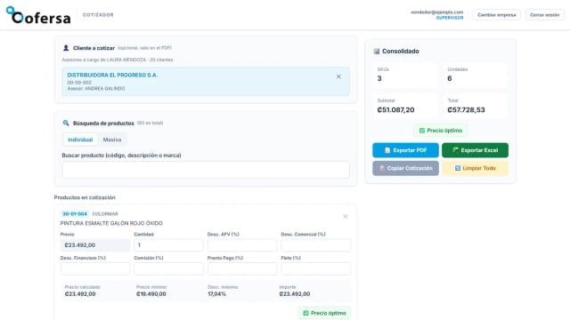
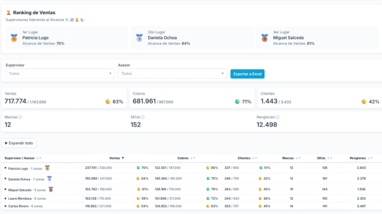
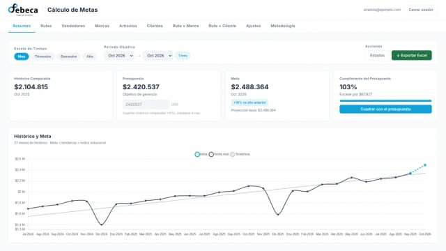

  

    

  

   

  
  
  

## Hola, soy Juan 👋

Desarrollador de software en Valencia, Venezuela. Me apasiona crear software funcional,
atractivo e intuitivo, con un enfoque especial en automatizar procesos manuales y repetitivos.

He desarrollado al menos diez aplicaciones para uso empresarial, cinco de ellas en producción.
La mayor parte de ese trabajo vive en repositorios privados por confidencialidad de las
empresas, así que lo cuento en detalle, con capturas y decisiones técnicas, en mi portfolio:
**[jscalon.dev](https://jscalon.dev)**.

## 🛠️ Tecnologías

  

## 🚀 Proyectos destacados

<table>
  <tr>
    <td width="33%" valign="top">
      
       <strong><a href="https://jscalon.dev/es/projects/quoting-tool/">Cotizador Mayoreo</a></strong>
       Cotizaciones con validación contra el precio mínimo en tiempo real. Lo usan a diario las cinco empresas del Grupo Mayoreo.
    </td>
    <td width="33%" valign="top">
      
       <strong><a href="https://jscalon.dev/es/projects/supervisor-portal/">Portal de Supervisores</a></strong>
       Seguimiento diario de la fuerza de ventas: cada supervisor ve solo a su equipo.
    </td>
    <td width="33%" valign="top">
      
       <strong><a href="https://jscalon.dev/es/projects/sales-goal-forecaster/">Pronóstico de Ventas</a></strong>
       Metas de venta a partir de un modelo de tendencia y estacionalidad.
    </td>
  </tr>
</table>

Código abierto: **[ServiFrescos](https://github.com/jscalon/servifrescos)**, gestión centralizada de
productos y precios para once tiendas minoristas, y **[jscalon.dev](https://github.com/jscalon/portfolio)**,
mi portfolio. Todos los casos, en **[jscalon.dev](https://jscalon.dev/es/projects/)**.

## 🐍 Contribuciones

<picture>
  <source media="(prefers-color-scheme: dark)" srcset="https://raw.githubusercontent.com/jscalon/jscalon/output/snake-dark.svg">
  <source media="(prefers-color-scheme: light)" srcset="https://raw.githubusercontent.com/jscalon/jscalon/output/snake.svg">
  
</picture>

---

<strong>English</strong>

## Hi, I'm Juan 👋

Software developer based in Valencia, Venezuela. I'm passionate about building functional,
attractive and intuitive software, with a particular focus on automating manual, repetitive
processes.

I have built at least ten applications for business use, five of them in production. Most of
that work lives in private repositories for confidentiality reasons, so I describe it in
detail — with screenshots and the technical decisions behind it — on my portfolio:
**[jscalon.dev](https://jscalon.dev/en/)**.

### Selected projects

- **[Mayoreo Quoting Tool](https://jscalon.dev/en/projects/quoting-tool/)** — every quote
  checked against the price floor in real time, used daily by all five Mayoreo Group companies.
- **[Supervisor Portal](https://jscalon.dev/en/projects/supervisor-portal/)** — daily tracking
  of the sales force, where each supervisor sees only their own team.
- **[Sales Forecast](https://jscalon.dev/en/projects/sales-goal-forecaster/)** — sales goals
  from a trend-and-seasonality model.

Open source: **[ServiFrescos](https://github.com/jscalon/servifrescos)**, centralized product
and price management for eleven retail stores, and **[jscalon.dev](https://github.com/jscalon/portfolio)**,
my portfolio. All the case studies are at **[jscalon.dev](https://jscalon.dev/en/projects/)**.

